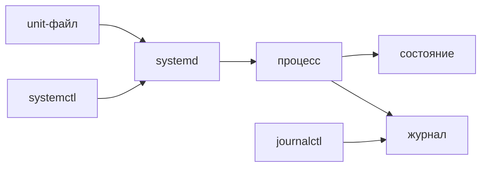
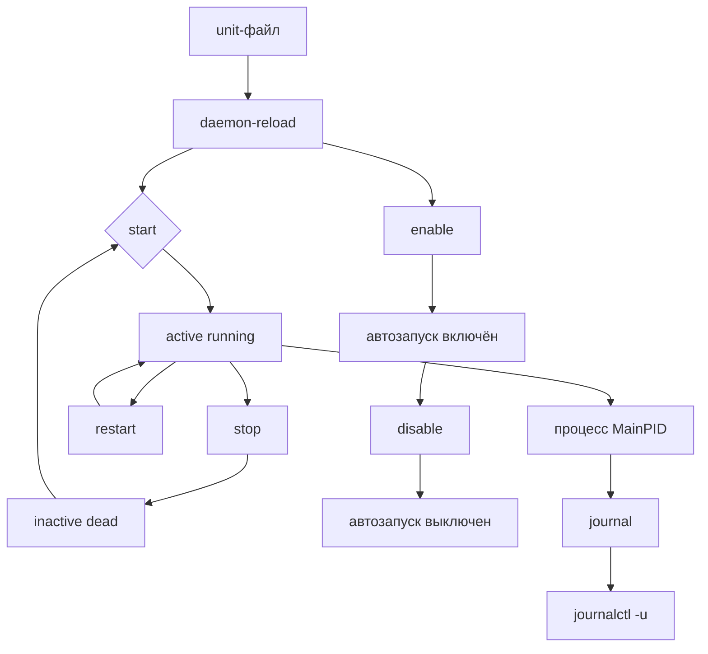
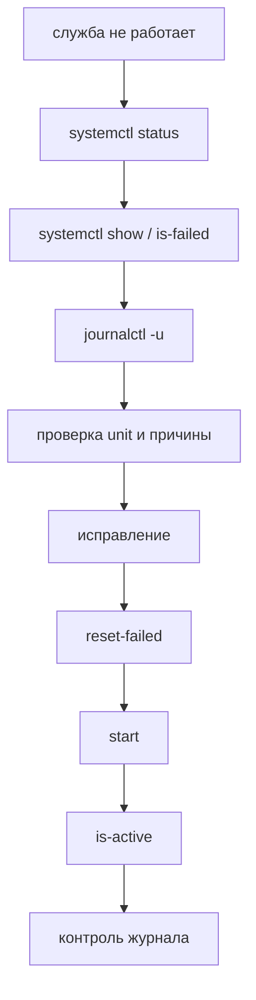

# Лабораторная работа № 35. Управление службами серверной ОС

**Дисциплина:** Управление работами и разработка программного обеспечения облачных систем  
**Результат обучения:** РО 3.2. Эксплуатировать облачные системы  
**Тема:** базовые операции эксплуатации служб Linux-сервера средствами `systemd`.

## Цель работы

Освоить эксплуатационный цикл управления службой Linux: проверить серверную среду, создать безопасный учебный фоновый процесс, оформить его как `systemd` service unit, управлять жизненным циклом командами `systemctl`, настроить и проверить автозапуск, получить диагностику через `journalctl`, воспроизвести контролируемый отказ, устранить причину и корректно удалить учебную службу.

## 1. Учебная среда

Работа выполнена в изолированной Linux-среде — привилегированном контейнере Ubuntu с полноценным `systemd` (PID 1). Отдельная VirtualBox VM в распоряжении отсутствовала, поэтому используется эквивалентная учебная Linux-среда с настоящим systemd, а не эмуляция команд.

| Параметр | Фактическое значение |
|---|---|
| ОС | Ubuntu 24.04.5 LTS |
| Ядро/виртуализация | Linux, контейнер Docker Desktop (`Virtualization: wsl` на уровне host) |
| PID 1 | `systemd` |
| Версия systemd | `systemd 255 (255.4-1ubuntu8.18)` |
| Состояние системы | `running` |
| Hostname | `ac88dabe5e7e` |
| Пользователь сеанса | `root` (в контейнере; `sudo` не требуется) |
| Python для worker | `/usr/bin/python3` (3.12.3) |
| Количество failed units до эксперимента | `0` |
| Количество failed units после очистки | `0` |

Проверка среды:

```text
$ ps -p 1 -o comm=
systemd

$ systemctl --version
systemd 255 (255.4-1ubuntu8.18)
...

$ systemctl is-system-running
running
```

Среда воспроизводится скриптом [`scripts/lr35/run_lab35.sh`](scripts/lr35/run_lab35.sh): он поднимает `jrei/systemd-ubuntu:24.04` с `--privileged --cgroupns=host`, копирует материалы и выполняет шаги. Полный журнал выполнения — [`docs/lr35_evidence.txt`](docs/lr35_evidence.txt) (695 строк).

## 2. Место работы в эксплуатационном блоке

ЛР №34 завершила разработческий блок РО 3.1. С ЛР №35 начинается эксплуатация: приложение существует не как команда в терминале, а как управляемый объект ОС. Схема:



- `systemctl` управляет состоянием unit;
- `journalctl` объясняет, что происходило с процессом.

## 3. Учебный процесс и unit-файл

Каталог `/opt/cloud-lab` создан с правами `0755`. Worker каждые 5 секунд печатает heartbeat, а при наличии `/opt/cloud-lab/fail.flag` завершается с кодом 42.

Код: [`deploy/systemd/service_worker.py`](deploy/systemd/service_worker.py).

```python
FAIL_FLAG = Path("/opt/cloud-lab/fail.flag")

if FAIL_FLAG.exists():
    print("STARTUP ERROR: fail.flag detected", file=sys.stderr, flush=True)
    raise SystemExit(42)

print("cloud-lab-worker started", flush=True)
while True:
    print("heartbeat", datetime.now(timezone.utc).isoformat(), flush=True)
    time.sleep(5)
```

Unit: [`deploy/systemd/cloud-lab-worker.service`](deploy/systemd/cloud-lab-worker.service).

```ini
[Unit]
Description=Cloud Lab Worker for PM3 LR35
After=network.target

[Service]
Type=simple
User=nobody
WorkingDirectory=/opt/cloud-lab
ExecStart=/usr/bin/python3 /opt/cloud-lab/service_worker.py
Restart=no
StandardOutput=journal
StandardError=journal

[Install]
WantedBy=multi-user.target
```

### Назначение секций

| Секция | Назначение | Ключевые параметры |
|---|---|---|
| `[Unit]` | Описание unit и зависимостей | `Description`, `After=network.target` |
| `[Service]` | Как запускать и сопровождать процесс | `Type=simple`, `User=nobody`, `WorkingDirectory`, `ExecStart`, `Restart=no`, `StandardOutput=journal` |
| `[Install]` | Как включать unit в автозапуск | `WantedBy=multi-user.target` |

`Type=simple` означает, что процесс из `ExecStart` сразу считается основным процессом службы. `User=nobody` не позволяет worker работать от root. `Restart=no` выбран намеренно: контролируемый отказ должен устойчиво приводить unit в состояние `failed`.

### Проверка unit

```text
$ systemd-analyze verify /etc/systemd/system/cloud-lab-worker.service
/etc/systemd/system/cloud-lab-worker.service:7: Special user nobody configured, this is not safe!
[exit=0]
```

Критических ошибок нет. Предупреждение связано с использованием системного пользователя `nobody`; в production следует создавать отдельную учётную запись приложения (это делается в ЛР №36 для `cloudapp`).

```text
$ systemctl daemon-reload
[exit=0]
```

`daemon-reload` перечитывает unit-конфигурацию, но не запускает службу.

## 4. Жизненный цикл службы

| Действие | ActiveState | SubState | MainPID |
|---|---|---|---|
| до запуска | `inactive` | `dead` | `0` |
| после `start` | `active` | `running` | `100` |
| после `stop` | `inactive` | `dead` | `0` |
| после повторного `start` | `active` | `running` | `112` |
| после `restart` | `active` | `running` | `117` |

Основные свойства после первого запуска:

```text
$ systemctl show cloud-lab-worker.service \
    -p ActiveState -p SubState -p MainPID -p ExecMainStatus -p UnitFileState
MainPID=100
ExecMainStatus=0
ActiveState=active
SubState=running
UnitFileState=disabled
```

Связь unit и процесса:

```text
$ ps -fp 100
UID          PID    PPID  C STIME TTY          TIME CMD
nobody       100       1 55 12:42 ?        00:00:00 /usr/bin/python3 /opt/cloud-lab/service_worker.py
```

Unit — это объект управления и описание. Процесс — реально выполняющийся экземпляр программы с конкретным PID. После `restart` PID изменился: `112 → 117`.

## 5. Текущее состояние и автозапуск

| Операция | Меняет состояние сейчас | Меняет автозапуск |
|---|---|---|
| `start` | да | нет |
| `stop` | да | нет |
| `restart` | да | нет |
| `enable` | нет | да |
| `disable` | нет | да |

### enable без start

```text
$ systemctl stop cloud-lab-worker.service
$ systemctl is-active cloud-lab-worker.service
inactive
$ systemctl enable cloud-lab-worker.service
Created symlink /etc/systemd/system/multi-user.target.wants/cloud-lab-worker.service -> ...
$ systemctl is-enabled cloud-lab-worker.service
enabled
$ systemctl is-active cloud-lab-worker.service
inactive
```

Служба включена в автозапуск, но прямо сейчас не работает.

### disable без stop

```text
$ systemctl disable cloud-lab-worker.service
Removed "/etc/systemd/system/multi-user.target.wants/cloud-lab-worker.service".
$ systemctl is-enabled cloud-lab-worker.service
disabled
$ systemctl is-active cloud-lab-worker.service
active
```

Служба отключена от автозапуска, но продолжает работать до явной остановки. Это доказывает, что `enable/disable` и `start/stop` — разные свойства.

## 6. Диагностика через journalctl

```text
$ journalctl -u cloud-lab-worker.service -n 20 --no-pager
... python3[142]: cloud-lab-worker started
... python3[142]: heartbeat 2026-11-22T12:42:45.054961+00:00
... python3[142]: heartbeat 2026-11-22T12:42:50.055274+00:00
... python3[142]: heartbeat 2026-11-22T12:42:55.055720+00:00
```

| Команда | Назначение | Наблюдение |
|---|---|---|
| `journalctl -u cloud-lab-worker.service` | журнал только одного unit | сообщения worker и systemd |
| `journalctl -u ... -b` | только текущая загрузка ОС | события этой загрузки |
| `journalctl -u ... --since "5 minutes ago"` | ограничение по времени | сообщения за последние 5 минут |
| `journalctl -f -u ...` | наблюдение в реальном времени | новые heartbeat каждые 5 секунд |

Во время `journalctl -f` служба оставалась `active`: `Ctrl+C`/`timeout` завершает просмотр журнала, а не процесс.

## 7. Контролируемый отказ и восстановление

```text
$ touch /opt/cloud-lab/fail.flag
$ systemctl restart cloud-lab-worker.service
$ systemctl is-active cloud-lab-worker.service
failed
$ systemctl is-failed cloud-lab-worker.service
failed
```

```text
$ systemctl status cloud-lab-worker.service --no-pager
x cloud-lab-worker.service - Cloud Lab Worker for PM3 LR35
     Active: failed (Result: exit-code) since Sun 2026-11-22 12:44:17 UTC; 1s ago
    Process: 196 ExecStart=/usr/bin/python3 /opt/cloud-lab/service_worker.py (code=exited, status=42)
   Main PID: 196 (code=exited, status=42)

... python3[196]: STARTUP ERROR: fail.flag detected
... systemd[1]: cloud-lab-worker.service: Main process exited, code=exited, status=42/n/a
... systemd[1]: cloud-lab-worker.service: Failed with result 'exit-code'.
```

```text
$ systemctl show cloud-lab-worker.service \
    -p ActiveState -p SubState -p Result -p ExecMainCode -p ExecMainStatus
ActiveState=failed
SubState=failed
Result=exit-code
ExecMainCode=1
ExecMainStatus=42
```

`systemctl --failed` показывает учебный unit среди failed. Причина определена по журналу, а не по предположению.

| Этап | Команда | Наблюдение |
|---|---|---|
| нормальное состояние | `systemctl status` | `active (running)`, heartbeat в журнале |
| после создания `fail.flag` | `systemctl is-failed` | `failed` |
| код завершения | `systemctl show` | `ExecMainStatus=42`, `Result=exit-code` |
| причина | `journalctl -u` | `STARTUP ERROR: fail.flag detected` |
| после удаления `fail.flag` | `systemctl reset-failed` | состояние сброшено |
| восстановление | `systemctl start` | `active` |
| итог | `systemctl is-active` | `active` |

Порядок восстановления: устранить причину → `reset-failed` (сбросить историческое состояние) → `start`. `reset-failed` сам по себе не исправляет ошибку.

```text
$ rm /opt/cloud-lab/fail.flag
$ systemctl reset-failed cloud-lab-worker.service
$ systemctl is-failed cloud-lab-worker.service
inactive
$ systemctl start cloud-lab-worker.service
$ systemctl is-active cloud-lab-worker.service
active
```

## 8. Самостоятельное исследование свойств unit

```text
$ systemctl show cloud-lab-worker.service \
    -p Description -p LoadState -p ActiveState -p SubState \
    -p UnitFileState -p User -p WorkingDirectory -p ExecStart -p MainPID
Description=Cloud Lab Worker for PM3 LR35
LoadState=loaded
ActiveState=active
SubState=running
UnitFileState=enabled
User=nobody
WorkingDirectory=/opt/cloud-lab
ExecStart={ path=/usr/bin/python3 ; argv[]=/usr/bin/python3 /opt/cloud-lab/service_worker.py ; ... }
MainPID=209
```

| Свойство | Значение | Назначение |
|---|---|---|
| `Description` | Cloud Lab Worker for PM3 LR35 | человекочитаемое описание |
| `LoadState` | loaded | unit успешно загружен менеджером |
| `ActiveState` | active | высокоуровневое состояние |
| `SubState` | running | низкоуровневое состояние |
| `UnitFileState` | enabled | включён автозапуск |
| `User` | nobody | непривилегированный пользователь процесса |
| `WorkingDirectory` | /opt/cloud-lab | рабочий каталог |
| `ExecStart` | `/usr/bin/python3 /opt/cloud-lab/service_worker.py` | команда запуска |
| `MainPID` | 209 | PID основного процесса |

### status, is-active и show

- `systemctl status` — человекочитаемый обзор: состояние, PID, последние строки журнала.
- `systemctl is-active` — краткая машинная проверка (`active/inactive/failed`) с кодом возврата.
- `systemctl show` — точный набор свойств для диагностики и сценариев автоматизации.

## 9. Дополнительное задание: Restart=on-failure

В unit заменено:

```ini
Restart=on-failure
RestartSec=2
```

После `daemon-reload`, создания `fail.flag` и запуска:

```text
$ systemctl status cloud-lab-worker.service --no-pager
     Active: activating (auto-restart) (Result: exit-code) since ...; 1s ago
    Process: 242 ExecStart=/usr/bin/python3 /opt/cloud-lab/service_worker.py (code=exited, status=42)

$ systemctl show cloud-lab-worker.service -p NRestarts -p ActiveState -p SubState -p StartLimitBurst
NRestarts=3
ActiveState=activating
SubState=auto-restart
StartLimitBurst=5
```

Docker/systemd автоматически перезапускал worker каждые 2 секунды, счётчик `NRestarts` вырос до 3. Автоматический restart не устраняет причину: после 5 попыток unit всё равно переходит в `failed`. Поэтому диагностика обязательна. После эксперимента `Restart=no` возвращён, `daemon-reload` и `reset-failed` выполнены, служба запущена и проверена.

## 10. Очистка учебной среды

```text
$ systemctl disable --now cloud-lab-worker.service
$ rm -f /etc/systemd/system/cloud-lab-worker.service
$ rm -rf /opt/cloud-lab
$ systemctl daemon-reload
$ systemctl reset-failed
$ systemctl status cloud-lab-worker.service --no-pager
Unit cloud-lab-worker.service could not be found.
[exit=4]
```

Количество failed units после очистки: `0`. Изменения выполнялись вне Git-репозитория Cloud Application (`/etc`, `/opt`), поэтому исходный код не менялся; в репозиторий добавлены только воспроизводимые материалы и отчёт.

## 11. Графические схемы

### Жизненный цикл службы



### Диагностика и восстановление



## 12. Ответы на контрольные вопросы

1. **Что называется службой серверной ОС?** Фоновый процесс (или набор процессов), которым управляет менеджер служб ОС: он запускается, останавливается и перезапускается по правилам unit-файла, а не по воле интерактивного пользователя.
2. **Чем служба отличается от обычного процесса?** У службы есть описание (unit) и управляемый жизненный цикл: состояние, автозапуск, журнал, политика перезапуска. Обычный процесс связан с терминалом и не имеет такого описания.
3. **Что представляет собой systemd?** Системный менеджер и PID 1 в большинстве современных Linux-дистрибутивов; управляет unit, зависимостями, журналом и загрузкой ОС.
4. **Что называется unit?** Единица конфигурации systemd (service, socket, timer, target и др.), описывающая объект и правила управления им.
5. **Для чего используется .service unit?** Для описания службы: команды запуска, пользователя, рабочего каталога, политики перезапуска, способа подключения к автозапуску.
6. **Для чего используется systemctl?** Для управления состоянием unit: start/stop/restart, enable/disable, status, show, daemon-reload.
7. **Что делает systemctl status?** Показывает загруженность unit, текущее/последнее состояние, MainPID и несколько последних строк журнала.
8. **Что делает systemctl start?** Запускает unit сейчас, не изменяя настройку автозапуска.
9. **Что делает systemctl stop?** Останавливает unit сейчас, не изменяя настройку автозапуска.
10. **Что делает systemctl restart?** Останавливает и снова запускает unit; обычно создаётся новый процесс с новым PID.
11. **Для чего используется systemctl is-active?** Для краткой проверки активного состояния с машинно-удобным кодом возврата.
12. **Что означает active (running)?** Unit активен, основной процесс выполняется.
13. **Что означает inactive?** Unit не активен; процесс не выполняется.
14. **Что означает failed?** Unit завершился с ошибкой и не был успешно остановлен/перезапущен; причина хранится в свойствах и журнале.
15. **Для чего используется systemctl is-failed?** Для проверки, находится ли unit в состоянии failed.
16. **Что такое MainPID?** PID основного процесса, которым управляет unit.
17. **Чем unit отличается от MainPID?** Unit — описание и объект управления; MainPID — идентификатор конкретного выполняющегося процесса.
18. **Для чего используется systemctl show?** Для получения конкретных свойств unit в точном, пригодном для сценариев виде.
19. **Зачем после изменения unit-файла выполняется daemon-reload?** Чтобы systemd перечитал конфигурацию с диска.
20. **Запускает ли daemon-reload службу?** Нет, он только перечитывает конфигурацию.
21. **Чем enable отличается от start?** `enable` включает автозапуск при загрузке; `start` запускает службу сейчас.
22. **Чем disable отличается от stop?** `disable` отключает автозапуск; `stop` останавливает службу сейчас.
23. **Может ли служба быть active и disabled одновременно?** Да: она работает, но не будет запущена автоматически после загрузки.
24. **Может ли служба быть inactive и enabled одновременно?** Да: автозапуск настроен, но сейчас служба остановлена.
25. **Для чего используется [Install]?** Для описания, как unit подключается к автозапуску (например, через WantedBy).
26. **Какое назначение имеет WantedBy=multi-user.target?** Unit включается в target многопользовательского режима и запускается при обычной загрузке.
27. **Для чего используется journalctl?** Для чтения журнала systemd и диагностики событий служб и системы.
28. **Как получить журнал только одной службы?** `journalctl -u имя.service`.
29. **Для чего используется journalctl -f?** Для наблюдения за новыми событиями в реальном времени.
30. **Останавливает ли Ctrl+C службу при просмотре journalctl -f?** Нет, завершается только просмотр журнала.
31. **Для чего используется ключ -b?** Ограничивает вывод событиями текущей загрузки ОС.
32. **Как ограничить журнал последними 20 событиями?** `journalctl -n 20`.
33. **Как выбрать события за последние пять минут?** `journalctl --since "5 minutes ago"`.
34. **Какая последовательность используется для первичной диагностики отказа?** status → свойства unit (show/is-failed) → журнал → конфигурация → исправление → повторный запуск.
35. **Что показывает ExecMainStatus?** Код завершения основного процесса.
36. **Почему в учебном отказе используется код 42?** Это заранее выбранный безопасный ненулевой код, однозначно указывающий на контролируемую ошибку.
37. **Для чего используется reset-failed?** Для сброса исторического failed-состояния unit.
38. **Устраняет ли reset-failed первопричину ошибки?** Нет, он только сбрасывает состояние.
39. **Почему сначала необходимо устранить причину, а затем запускать службу?** Иначе служба снова упадёт; reset-failed без исправления лишь маскирует проблему.
40. **Для чего используется Restart=on-failure?** Для автоматического перезапуска при аварийном завершении.
41. **Почему автоматический restart не заменяет диагностику?** Он не устраняет причину; при повторяющейся ошибке unit исчерпает лимит и перейдёт в failed.
42. **Почему на удалённом сервере нельзя без необходимости останавливать SSH?** Можно потерять удалённый доступ и возможность исправления; эксплуатационные эксперименты выполняются только с выделенной учебной службой.

## 13. Вывод

В ходе ЛР №35 освоен полный эксплуатационный цикл службы Linux: проверка systemd-среды, создание безопасного worker и unit-файла, `daemon-reload`, запуск, проверка `active (running)`, определение `MainPID`, остановка, повторный запуск, `restart` со сменой PID, исследование различий `start/enable` и `stop/disable`, работа с `journalctl` (unit, текущая загрузка, интервал, режим `-f`), воспроизведение контролируемого отказа с `ExecMainStatus=42`, диагностика по журналу, `reset-failed` и восстановление, а также корректная очистка среды. Дополнительно проверена политика `Restart=on-failure` (`NRestarts=3`, `activating/auto-restart`). Полученные навыки применяются в ЛР №36 при развертывании реального Cloud Application как systemd-службы.

## Воспроизведение

```bash
# из корня репозитория, при запущенном Docker Desktop
bash labs/lab-35/scripts/lr35/run_lab35.sh
```

Скрипт создаёт временный контейнер, выполняет все шаги и сохраняет вывод в `labs/lab-35/docs/lr35_evidence.txt`, после чего удаляет контейнер.
