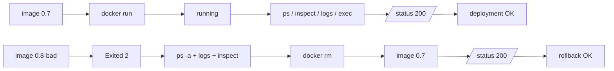

# Лабораторная работа № 37. Развертывание контейнеризированного приложения

**Дисциплина:** Управление работами и разработка программного обеспечения облачных систем  
**Результат обучения:** РО 3.2. Эксплуатировать облачные системы  
**Тема:** контейнерный deployment Cloud Application: image из зафиксированной Git-ревизии, внешняя runtime-конфигурация и секреты, restart policy, loopback-публикация, диагностика и rollback по image tag.

## Цель работы

Развернуть Cloud Application в контейнерной модели: собрать image из зафиксированной версии Git и связать его с commit hash, отделить runtime-конфигурацию и секреты от образа, запустить контейнер с политикой перезапуска `unless-stopped` и публикацией `127.0.0.1:8080:8000`, выполнить smoke-проверку, исследовать жизненный цикл контейнера и отработать rollback на проверенный image после неуспешного release.

## 1. Модель deployment и среда выполнения

```mermaid
flowchart LR
    G[Git commit fb7e384] --> B[docker build]
    B --> I[cloud-application:0.7]
    I --> R[docker run]
    E[env-file вне image] --> R
    S[secrets read-only mount] --> R
    R --> C[cloud-application-lr37]
    C --> H[127.0.0.1:8080]
    H --> ST[/status]
    C --> P[appuser / UID 1000]
    C --> RP[restart unless-stopped]
```

В отличие от ЛР №36, операционная система больше не запускает Python-процесс напрямую. Deployment artifact — Docker image, а эксплуатационным объектом становится контейнер.

| Параметр | Принятое значение | Фактически |
|---|---|---|
| Среда выполнения | Linux-сервер с Docker Engine | Docker Desktop 29.9.3, Linux containers |
| Docker daemon | active | active, `server=29.9.3 os=linux` |
| Git commit | зафиксирован | `fb7e384b2fbcdd6bdc11f4730dba26a8f9399981` |
| Base image | python:3.13-slim | python:3.13-slim, Python 3.13.18 |
| Пользователь контейнера | appuser, непривилегированный | `uid=1000(appuser) gid=1000(appuser)` |
| Рабочий каталог | /app | `/app` |
| Runtime-конфигурация | env-файл вне image | `deploy/etc/cloud-application.env` |
| Секреты | отдельный каталог, read-only mount | `runtime/secrets` → `/app/secrets`, `RW=false` |
| Публикация порта | 127.0.0.1:8080 → 8000/tcp | `127.0.0.1:8080->8000/tcp` |
| Restart policy | unless-stopped | unless-stopped |
| Проверка | GET /status | HTTP 200 |
| Внешний сетевой доступ | не настраивается | только loopback |

> **Отклонение от идеальной схемы.** Отдельная VirtualBox VM с Linux отсутствовала, поэтому работа выполнена на Docker Desktop (Linux containers) под Windows 10. Команды `docker build/run/inspect/logs/exec/port`, privileges, mount и публикация порта работают без эмуляции. Поскольку Docker daemon в этой среде выполняется внутри служебной Linux-VM, проверка `ss -ltn` на Windows-host неприменима; фактический bind подтверждён `docker port` и колонкой `PORTS` в `docker ps`.

## 2. Сборка image из зафиксированной версии

Dockerfile наследуется из РО 3.1 и не содержит секретов: зависимости ставятся отдельным слоем, исходный код копируется от `appuser`, конфигурация и секреты в образ не входят.

```dockerfile
FROM python:3.13-slim

ENV PYTHONDONTWRITEBYTECODE=1 \
    PYTHONUNBUFFERED=1 \
    PIP_NO_CACHE_DIR=1 \
    PIP_DISABLE_PIP_VERSION_CHECK=1

WORKDIR /app

COPY requirements.txt ./
RUN python -m pip install --no-cache-dir -r requirements.txt

RUN useradd --create-home --shell /usr/sbin/nologin appuser \
    && mkdir -p /app/storage/objects \
    && chown -R appuser:appuser /app/storage

COPY --chown=appuser:appuser app ./app
COPY --chown=appuser:appuser migrations ./migrations
COPY --chown=appuser:appuser alembic.ini ./
COPY --chown=appuser:appuser run.py ./

USER appuser

EXPOSE 8000

LABEL org.opencontainers.image.title="Cloud Application" \
      org.opencontainers.image.version="0.7" \
      org.opencontainers.image.description="Cloud Application REST API on FastAPI"

CMD ["python", "run.py"]
```

Сборка с OCI-меткой ревизии:

```bash
COMMIT=$(git rev-parse HEAD)
docker build \
  --label "org.opencontainers.image.revision=$COMMIT" \
  -t cloud-application:0.7 .
```

```text
$ docker image ls cloud-application
IMAGE                   ID             DISK USAGE   CONTENT SIZE
cloud-application:0.7   06857787dadf        297MB         70.4MB

Image ID:        sha256:06857787dadf4732f87de9e2d43387d1edbcf48f947e47eb6b3ed015cf10dcd8
Revision label:  fb7e384b2fbcdd6bdc11f4730dba26a8f9399981
Git commit:      fb7e384b2fbcdd6bdc11f4730dba26a8f9399981
```

### Таблица идентификации версии

| Параметр | Значение |
|---|---|
| Git commit | `fb7e384b2fbcdd6bdc11f4730dba26a8f9399981` |
| Image tag | `cloud-application:0.7` |
| Image ID | `sha256:06857787dadf4732f87de9e2d43387d1edbcf48f947e47eb6b3ed015cf10dcd8` |
| Revision label | `fb7e384b2fbcdd6bdc11f4730dba26a8f9399981` |
| Совпадение label и commit | да |
| Дата deployment | 2026-11-22 |

## 3. Runtime-конфигурация и секреты

Обычные параметры передаются через `--env-file` и не встраиваются в image. Внутри контейнера приложение обязано слушать `0.0.0.0:8000`, поэтому `APP_HOST` переопределяется при запуске; на host порт остаётся на loopback.

| Файл | Назначение | В image |
|---|---|---|
| `deploy/etc/cloud-application.env` | runtime-параметры (APP_*, DB_*, LOG_LEVEL) | нет |
| `runtime/secrets/auth_secret` | секрет аутентификации | нет |
| `runtime/secrets/lab_db_password` | учебный пароль БД | нет |

Каталог `runtime/` исключён из Git (`.gitignore`) и из build context (`.dockerignore`).

UID/GID контейнерного пользователя определяются без запуска приложения:

```bash
APP_UID=$(docker run --rm --entrypoint id cloud-application:0.7 -u)
APP_GID=$(docker run --rm --entrypoint id cloud-application:0.7 -g)
```

```text
uid=1000 gid=1000
uid=1000(appuser) gid=1000(appuser) groups=1000(appuser)
appuser
```

Секреты созданы заново для контейнерного deployment (учебные значения, сгенерированы `secrets.token_urlsafe`), их содержимое в отчёт не выводится:

```text
$ ls -l runtime/secrets
auth_secret        45 bytes
lab_db_password    34 bytes
```

## 4. Запуск и проверка контейнера

```bash
docker run -d \
  --name cloud-application-lr37 \
  --restart unless-stopped \
  -p 127.0.0.1:8080:8000 \
  --env-file deploy/etc/cloud-application.env \
  -e APP_HOST=0.0.0.0 \
  -e APP_PORT=8000 \
  -e HTTPS_ENABLED=false \
  --mount type=bind,src=<abs>/runtime/secrets,dst=/app/secrets,readonly \
  cloud-application:0.7
```

| Проверка | Команда | Результат |
|---|---|---|
| Состояние | `docker ps` | `Up`, `127.0.0.1:8080->8000/tcp` |
| State | `docker inspect -f '{{.State.Status}}'` | `running` |
| Published port | `docker port cloud-application-lr37` | `8000/tcp -> 127.0.0.1:8080` |
| Restart policy | `inspect .HostConfig.RestartPolicy.Name` | `unless-stopped` |
| Image контейнера | `inspect .Image` | `sha256:06857787dadf...` = Image ID образа |
| Mount | `inspect .Mounts` | `/app/secrets`, `"RW":false` |
| Пользователь | `docker exec ... whoami` | `appuser` |
| Рабочий каталог | `docker exec ... pwd` | `/app` |
| Python | `docker exec ... python --version` | Python 3.13.18 |
| Секрет auth | `test -r` | `AUTH_SECRET_READABLE` |
| Секрет БД | `test -r` | `DB_SECRET_READABLE` |
| Запись в секрет | `test -w` | `READ_ONLY_CONFIRMED` |

Фрагмент `docker inspect .Mounts`:

```json
[{"Type":"bind","Source":"...\\runtime\\secrets","Destination":"/app/secrets","Mode":"","RW":false,"Propagation":"rprivate"}]
```

## 5. Журнал и smoke-test

```text
$ docker logs --tail 40 cloud-application-lr37
{"timestamp": "2026-11-22T12:56:02.790579+00:00", "level": "INFO", "logger": "app.main",
 "message": "Cloud Application configured", "service": "cloud-application",
 "event": "application_configured"}
INFO:     Started server process [1]
INFO:     Waiting for application startup.
INFO:     Application startup complete.
INFO:     Uvicorn running on http://0.0.0.0:8000 (Press CTRL+C to quit)
```

```text
$ curl -i http://127.0.0.1:8080/status
HTTP/1.1 200 OK
server: uvicorn
content-type: application/json
{"status":"ok","service":"CloudApplication","environment":"production","debug":false,"api_prefix":"/api"}

$ curl -s -o /dev/null -w '%{http_code}\n' http://127.0.0.1:8080/docs
200
$ curl -s -o /dev/null -w '%{http_code}\n' http://127.0.0.1:8080/openapi.json
200
```

### Критерии успешного container deployment

| Проверка | Ожидаемый результат | Факт |
|---|---|---|
| Docker daemon | active | active |
| Image tag | cloud-application:0.7 | cloud-application:0.7 |
| Revision label | совпадает с Git commit | совпадает |
| Container | running | running |
| Restart policy | unless-stopped | unless-stopped |
| Container user | appuser | appuser |
| Secrets mount | read-only | `RW=false`, `READ_ONLY_CONFIRMED` |
| Host bind | 127.0.0.1:8080 | 127.0.0.1:8080 |
| /status | успешный ответ | HTTP 200 |
| /docs | 200 | 200 |
| Logs | без критической ошибки | Uvicorn запущен штатно |

## 6. Жизненный цикл контейнера

| Действие | Наблюдение | Проверка |
|---|---|---|
| `docker stop` | контейнер исчез из `docker ps`, в `ps -a` — `Exited (0)` | — |
| `docker start` | снова `Up` | /status = 200 |
| `docker restart` | PID изменился | PID 10760 → 10853 |
| после restart | сервис отвечает | /status = 200 |



## 7. Неуспешный release и rollback

Учебный неработающий image собирается из стабильного добавлением несуществующего entrypoint:

```dockerfile
FROM cloud-application:0.7

CMD ["python", "/app/missing_run.py"]
```

```text
$ docker build -t cloud-application:0.8-bad <bad-context>
$ docker run -d --name cloud-application-lr37 --restart no ... cloud-application:0.8-bad

$ docker ps -a --filter name=cloud-application-lr37
NAMES                    STATUS
cloud-application-lr37   Exited (2) 4 seconds ago

$ docker logs cloud-application-lr37
python: can't open file '/app/missing_run.py': [Errno 2] No such file or directory

$ docker inspect ... -f 'image={{.Config.Image}} exit={{.State.ExitCode}} status={{.State.Status}}'
image=cloud-application:0.8-bad exit=2 status=exited
```

Перед удалением зафиксированы: запускавшийся image, exit code `2`, журнал причины, статус `exited`, использованные runtime-параметры. Затем контейнер удалён, запущен стабильный image `0.7`.

| Проверка после rollback | Результат |
|---|---|
| `docker ps` | `Up`, `127.0.0.1:8080->8000/tcp` |
| `.Config.Image` | `cloud-application:0.7` |
| Restart policy | `unless-stopped` |
| Mount | `/app/secrets`, `RW=false` |
| `/status` | HTTP 200 |
| `cloud-application:0.8-bad` | удалён после фиксации результатов |

## 8. Сравнение ЛР №36 и ЛР №37

| Характеристика | ЛР №36: systemd + venv | ЛР №37: Docker |
|---|---|---|
| Изоляция Python-зависимостей | venv на хосте | внутри image |
| Артефакт deployment | каталог проекта + venv | image `cloud-application:0.7` |
| Кто запускает приложение | systemd | Docker daemon |
| Где хранится runtime-код | `/opt/cloud-application/app` | слои image |
| Конфигурация | `EnvironmentFile` | `--env-file` при `docker run` |
| Секреты | `/etc/cloud-application/secrets` + symlink | read-only bind mount `/app/secrets` |
| Автозапуск/восстановление | `enable --now`, `Restart=on-failure` | `--restart unless-stopped` |
| Журнал | journald | `docker logs` |
| Проверка состояния | `systemctl status`, `ss` | `docker ps`, `inspect`, `port` |
| Rollback | восстановление env-файла | возврат на предыдущий image tag |

Главный выигрыш контейнерной модели — воспроизводимость: один и тот же image с одинаковым набором зависимостей разворачивается на любом Docker host, а rollback возвращает не конфигурацию, а проверенный artifact.

## 9. Паспорт контейнерного deployment

| Параметр | Фактическое значение |
|---|---|
| hostname | `DESKTOP-3FUHFLF` |
| Docker version | 29.9.3 (server 29.9.3, linux) |
| Docker daemon | active |
| Git commit | `fb7e384b2fbcdd6bdc11f4730dba26a8f9399981` |
| Image tag | `cloud-application:0.7` |
| Image ID | `sha256:06857787dadf4732f87de9e2d43387d1edbcf48f947e47eb6b3ed015cf10dcd8` |
| Revision label | `fb7e384b2fbcdd6bdc11f4730dba26a8f9399981` |
| Container name | `cloud-application-lr37` |
| Container status | running |
| Container PID | 11061 (после rollback) |
| Container user | appuser (UID/GID 1000) |
| Restart policy | unless-stopped |
| Host bind | 127.0.0.1:8080 |
| Container port | 8000/tcp |
| Secrets mount | `/app/secrets`, read-only |
| /status | 200 |
| /docs | 200 |
| Последний rollback | 0.8-bad → 0.7, успешно |

## 10. Ответы на контрольные вопросы

1. **Контейнерный image** — неизменяемый шаблон файловой системы и метаданных (базовый образ, слои, команда запуска, пользователь), из которого создаются контейнеры.
2. **Container** — запущенный экземпляр image с собственными процессами, файловой системой (copy-on-write слоем), сетью и параметрами.
3. **Отличие** — image статичен и версионируется тегом; контейнер — его исполняемый экземпляр с состоянием. Один image порождает много контейнеров.
4. **Deployment artifact** — image `cloud-application:0.7`, связанный с Git commit и хранимый в реестре/локально.
5. **Связь с commit** — позволяет однозначно ответить, какой исходный код работает, и воспроизвести сборку.
6. **Tag** — человекочитаемая метка версии (`0.7`), указывающая на конкретный Image ID; удобна для выбора версии при запуске и rollback.
7. **Image ID** — криптографический digest содержимого image (sha256), однозначно идентифицирующий артефакт.
8. **OCI-метка revision** — хранит commit hash внутри метаданных image, связывая artifact с ревизией кода без внешней таблицы.
9. **Конфигурация вне image** — один image должен запускаться в разных средах (dev/test/prod); параметры передаются при старте контейнера.
10. **Секреты не в Dockerfile** — слои image доступны любому, кто его получил; секреты передаются отдельно с ограниченными правами.
11. **`--env-file`** — передаёт набор переменных среды контейнеру при запуске, не изменяя image.
12. **`APP_HOST=0.0.0.0`** — приложение обязано слушать все интерфейсы контейнера, иначе Docker не сможет перенаправить published port.
13. **Host bind 127.0.0.1** — порт доступен только с самого сервера, внешний доступ не открывается до ЛР №39.
14. **`127.0.0.1:8080:8000`** — host 127.0.0.1:8080 → container 8000/tcp.
15. **Внешний доступ не рассматривается** — это граница ЛР №39 (сетевой доступ) и ЛР №40 (ограничения).
16. **Bind mount** — монтирует каталог хоста в контейнер, позволяя держать данные и секреты вне image.
17. **Read-only** — приложение не должно изменять секреты; защита от компрометации и случайной записи.
18. **UID/GID** — права bind mount проверяются по числовым идентификаторам; несовпадение делает секреты недоступными.
19. **Определение UID** — `docker run --rm --entrypoint id image -u` (и `-g`), без запуска основного приложения.
20. **`docker inspect`** — показывает полную runtime-конфигурацию контейнера: state, image, restart policy, mounts, env.
21. **`docker ps`** — список работающих контейнеров с образом, статусом и портами.
22. **`ps -a`** — включает остановленные и завершившиеся контейнеры с exit code, что важно для диагностики.
23. **`docker logs`** — stdout/stderr контейнера (журнал приложения, ошибки запуска).
24. **`docker logs -f`** — потоковое слежение за журналом в реальном времени.
25. **Ctrl+C** — прекращает только просмотр логов, контейнер продолжает работать.
26. **`docker exec`** — выполняет команду внутри работающего контейнера (проверка пользователя, файлов, сети).
27. **Пользователь** — `docker exec <c> whoami`, либо `id` внутри контейнера.
28. **Restart policy** — задаёт автоматическое восстановление контейнера после сбоя или перезапуска Docker daemon.
29. **`unless-stopped`** — перезапускает контейнер после сбоя и старта daemon, но не после ручной остановки администратором; без политики контейнер останется остановленным.
30. **Без отдельной systemd-службы** — Docker daemon сам является системной службой, а жизненным циклом контейнера управляет restart policy.
31. **`docker stop`** — отправляет SIGTERM и после таймаута SIGKILL, контейнер переходит в Exited.
32. **`docker start`** — запускает существующий остановленный контейнер с прежней конфигурацией.
33. **`docker restart`** — stop + start за одну команду.
34. **Смена PID** — при restart создаётся новый процесс контейнера, поэтому host PID меняется.
35. **Smoke-test** — минимальная проверка работоспособности после deployment (HTTP 200 на `/status`, доступность `/docs`).
36. **Повторный /status после rollback** — подтверждает, что восстановлен именно рабочий artifact, а не только запущен контейнер.
37. **Не удалять сразу** — нужно сохранить диагностическую информацию о причине отказа.
38. **Зафиксировать** — image, exit code, статус, журнал, runtime-параметры (env, ports, mounts).
39. **Rollback по image tag** — запуск ранее проверенного тега (`0.7`) вместо неуспешного (`0.8-bad`).
40. **Stable image не удаляется** — он является точкой возврата; удаление лишает возможности откатиться.
41. **Отличие rollback** — в ЛР №36 восстанавливался конфигурационный файл, в ЛР №37 — предыдущий image как artifact.
42. **Без полного compose.yaml** — в ЛР №37 исследуется одиночный контейнер; многокомпонентная система — ЛР №38.
43. **ЛР №38** — PostgreSQL, Notification Service, миграции, внутренняя сеть Compose, постоянное хранение.
44. **Преимущество неизменяемого image** — одинаковый artifact воспроизводимо разворачивается в любой среде, а версия однозначно идентифицируется digest и меткой.
45. **Отличие от ЛР №27** — там контейнер использовался в разработке; здесь image — эксплуатационный artifact с версионированием, внешней конфигурацией, restart policy, smoke-test и rollback.

## 11. Вывод

Cloud Application развернуто в контейнерной модели. Из ревизии `fb7e384` собран image `cloud-application:0.7` (`sha256:06857787dadf…`) с OCI-меткой commit hash. Runtime-конфигурация передаётся через `--env-file`, секреты вынесены в отдельный каталог и подключены read-only bind mount с учётом UID/GID `appuser` (1000:1000). Контейнер `cloud-application-lr37` работает с политикой `unless-stopped`, порт опубликован только на `127.0.0.1:8080`. Проверены `ps`, `inspect`, `logs`, `exec`, mount, пользователь, `/status` (200) и `/docs` (200), выполнены stop/start/restart со сменой PID. Учебный image `0.8-bad` завершился с кодом 2 из-за отсутствующего `/app/missing_run.py`; после фиксации диагностики выполнен rollback на `0.7` и повторный успешный smoke-test. PostgreSQL и Notification Service намеренно не разворачивались — это содержание ЛР №38.

## Воспроизведение

```bash
cd labs/lab-37
bash scripts/lr37/run_lab37.sh
```

Скрипт собирает image, создаёт учебные секреты в `runtime/` (исключён из Git), запускает контейнер, выполняет все проверки, воспроизводит неуспешный release и rollback. Полный журнал — [docs/lr37_evidence.txt](docs/lr37_evidence.txt). После выполнения стабильный контейнер `cloud-application-lr37` остаётся запущенным.

Остановка и очистка:

```bash
docker rm -f cloud-application-lr37
docker image rm cloud-application:0.7
rm -rf runtime
```
