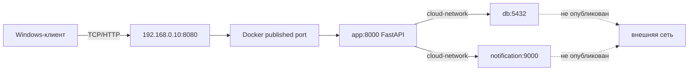
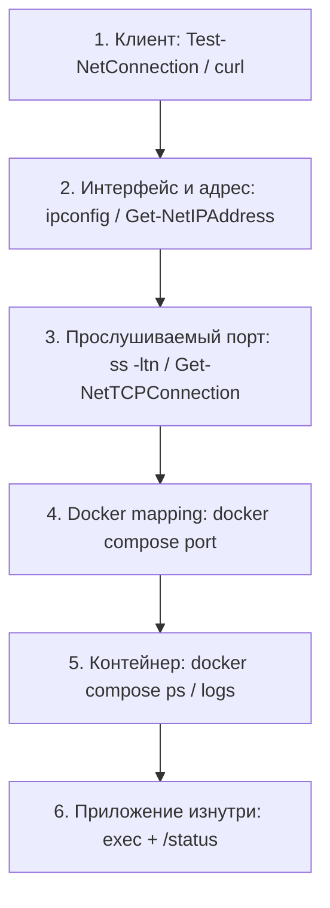

# Лабораторная работа № 39. Настройка сетевого доступа к приложению

**Дисциплина:** Управление работами и разработка программного обеспечения облачных систем  
**Результат обучения:** РО 3.2. Эксплуатировать облачные системы  
**Тема:** публикация Compose-приложения на сетевом интерфейсе, проверка TCP/HTTP-доступа с клиентского компьютера, подтверждение недоступности внутренних сервисов и последовательная диагностика сетевого пути.

## Цель работы

Настроить сетевой доступ к многокомпонентной системе Cloud Application: определить адреса и интерфейсы, изменить публикацию Docker Compose-приложения с loopback на сетевой интерфейс, проверить TCP- и HTTP-доступ с другого адреса, подтвердить недоступность PostgreSQL и Notification Service снаружи, отработать контролируемый отказ bind-address и восстановление, заполнить эксплуатационный сетевой паспорт.

## 1. Сетевая модель лабораторной среды

Используется Compose-система из ЛР №38 (в репозитории — `compose.yaml`): сервисы `app`, `db`, `notification` и одноразовый `migrate`.



| Параметр | Принятое значение | Фактически |
|---|---|---|
| Среда | Linux-VM + Docker | Windows 10 + Docker Desktop 29.9.3, Linux containers |
| «Лабораторный» интерфейс | Host-only Adapter | сетевой интерфейс Windows «Беспроводная сеть 2» |
| Адрес интерфейса | `VM_LAB_IP` | `192.168.0.10` |
| Маска | /24 | `255.255.255.0` |
| Шлюз | — | `192.168.0.1` |
| NAT | Adapter 1 | Windows-host + служебная Linux-VM Docker Desktop |
| Compose project | cloudapp-lr38 | `cloudapp-lr39` |
| app | 8000/tcp | `192.168.0.10:8080 -> 8000/tcp` |
| db | 5432/tcp | не опубликован |
| notification | 9000/tcp | не опубликован |
| Проверка | TCP + HTTP | `Test-NetConnection`, `curl`, `Invoke-WebRequest` |

> **Отклонение от идеальной схемы.** Отдельная VirtualBox VM отсутствовала, поэтому работа выполнена на Windows-host с Docker Desktop. Вместо Host-only Adapter используется сетевой IPv4-адрес Windows `192.168.0.10/24`: он не является loopback и требует явной публикации Docker-порта, поэтому демонстрирует те же свойства, что и Host-only адрес VM. NAT-доступ в Интернет обеспечивает обычное подключение Windows. Порт проверяется с того же компьютера по сетевому адресу, а не по `127.0.0.1`; второй клиентский компьютер в среде отсутствовал.

### Граница с ЛР №40

В ЛР №39 решается только вопрос доступности: как опубликовать приложение на сетевом интерфейсе. Firewall-правила, фильтрация по IP-источнику и ограничения доступа не настраиваются — это содержание ЛР №40.

## 2. Определение адресов и интерфейсов

```text
$ ipconfig            # фрагмент
Адаптер «Беспроводная сеть 2»:
   IPv4-адрес . . . . . . . . . . . . : 192.168.0.10
   Маска подсети  . . . . . . . . . . : 255.255.255.0
   Основной шлюз  . . . . . . . . . . : 192.168.0.1
```

```text
$ Get-NetIPAddress -AddressFamily IPv4 | Where-Object { $_.IPAddress -notlike '127.*' }
InterfaceAlias      IPAddress      PrefixLength
------------------  -------------  ------------
ZeroTier One        172.27.170.85          16
vEthernet (WSL)     172.18.112.1           20
Беспроводная сеть 2 192.168.0.10           24
Ethernet            10.10.1.61             22
```

Адрес `192.168.0.10` выбран как лабораторный: он принадлежит физическому интерфейсу, не является loopback и не используется Docker Desktop для служебной сети WSL.

```bash
VM_LAB_IP=192.168.0.10
```

Проверка firewall: правила Windows Firewall в ЛР №39 не изменялись. Docker Desktop получает доступ к порту через собственный backend; ограничения доступа рассматриваются в ЛР №40.

## 3. Исходное состояние Compose и loopback-публикация

Перед работой одиночный контейнер ЛР №37 остановлен, чтобы освободить порт 8080; image `cloud-application:0.7` сохранён.

```text
$ docker compose -p cloudapp-lr39 ps
NAME                           SERVICE        STATUS                    PORTS
cloudapp-lr39-app-1            app            Up (healthy)              127.0.0.1:8080->8000/tcp
cloudapp-lr39-db-1             db             Up (healthy)              5432/tcp
cloudapp-lr39-notification-1   notification   Up                        8000/tcp

$ docker compose port app 8000
127.0.0.1:8080

$ Get-NetTCPConnection -State Listen -LocalPort 8080
LocalAddress LocalPort OwningProcess
------------ --------- -------------
127.0.0.1         8080         15116
```

Локальная проверка:

```text
$ curl -s -o /dev/null -w '%{http_code}\n' http://127.0.0.1:8080/status
200
$ curl -s -o /dev/null -w '%{http_code}\n' http://127.0.0.1:8080/docs
200
```

Исходная проверка с сетевого адреса:

```text
$ Test-NetConnection -ComputerName 192.168.0.10 -Port 8080 -InformationLevel Quiet
False
$ curl --max-time 5 http://192.168.0.10:8080/status
curl: (7) Failed to connect to 192.168.0.10:8080 ... Could not connect to server
```

Процесс работает и отвечает локально, но loopback-публикация недоступна по сетевому адресу — это и есть исходное состояние.

## 4. Изменение публикации порта

В `compose.yaml` сервис `app` переведён на переменную host bind:

```yaml
    ports:
      - "${APP_PUBLISH_IP}:8080:8000"
```

Рядом с `compose.yaml` создан `.env`, содержащий только Compose-переменную:

```text
APP_PUBLISH_IP=192.168.0.10
```

Runtime-параметры приложения при этом остаются в отдельном файле `deploy/etc/cloud-application.env`, который подключён как `env_file` сервисов `app` и `migrate`. Это два разных механизма:

| Файл | Кто читает | Назначение |
|---|---|---|
| `.env` | Docker Compose | подстановка `${APP_PUBLISH_IP}` в compose.yaml |
| `deploy/etc/cloud-application.env` | контейнер (env_file) | runtime-параметры приложения (APP_*, DB_*, LOG_LEVEL) |

Пересоздаётся только сервис `app`:

```bash
docker compose config --quiet
docker compose up -d --force-recreate app
```

```text
$ docker compose port app 8000
192.168.0.10:8080
$ Get-NetTCPConnection -State Listen -LocalPort 8080
LocalAddress LocalPort OwningProcess
------------ --------- -------------
192.168.0.10      8080         15116
$ docker compose ps
app            Up (healthy)   192.168.0.10:8080->8000/tcp
db             Up (healthy)   5432/tcp
notification   Up             8000/tcp
```

После смены bind обращение к `127.0.0.1:8080` перестаёт работать (`status=000`), что подтверждает: Docker слушает только выбранный адрес.

## 5. Проверка с клиентского компьютера

```text
$ Test-NetConnection -ComputerName 192.168.0.10 -Port 8080
TcpTestSucceeded : True

$ curl.exe --noproxy "*" -i http://192.168.0.10:8080/status
HTTP/1.1 200 OK
server: uvicorn
content-type: application/json
{"status":"ok","service":"CloudApplication","environment":"production","debug":false,"api_prefix":"/api"}

$ Invoke-WebRequest -UseBasicParsing -Uri http://192.168.0.10:8080/docs
StatusCode
----------
       200
```

Swagger UI доступен по адресу `http://192.168.0.10:8080/docs`, `GET /status` выполняется из браузера.

## 6. Инфраструктурные порты не опубликованы

```text
$ docker inspect cloudapp-lr39-db-1 --format '{{json .NetworkSettings.Ports}}'
{"5432/tcp":null}
$ docker inspect cloudapp-lr39-notification-1 --format '{{json .NetworkSettings.Ports}}'
{"8000/tcp":null}
$ docker compose port notification 9000
no port 9000/tcp for container cloudapp-lr39-notification-1: 8000/tcp
$ curl --max-time 5 http://192.168.0.10:9000/status
curl: (7) Failed to connect ... Could not connect to server
```

Проверка PostgreSQL:

```text
$ Test-NetConnection -ComputerName 192.168.0.10 -Port 5432 -InformationLevel Quiet
False
```

> **Особенность среды.** На Windows-host порт 5432 постоянно занимает посторонний контейнер `ticket-postgres` (`0.0.0.0:5432->5432/tcp`) из другого учебного проекта. Он не относится к `cloudapp-lr39`. Чтобы проверка отражала именно наш стек, контейнер был приостановлен на несколько секунд, проверка выполнена, затем контейнер возвращён в состояние `running`. Независимо от этого `docker inspect` нашего `db` показывает `{"5432/tcp":null}`.

`docker compose port db 5432` в Compose v5 печатает `:0` — это особенность вывода для сервиса без публикации; авторитетным подтверждением служит `NetworkSettings.Ports = null` и колонка `PORTS` в `docker compose ps` (`5432/tcp` без host-адреса).

### Таблица доступности

| Источник | Адрес | Порт | Ожидание | Факт |
|---|---|---|---|---|
| Windows-клиент | 192.168.0.10 | 8080 | доступен | доступен (TCP True, HTTP 200) |
| Windows-клиент | 192.168.0.10 | 5432 | недоступен | недоступен |
| Windows-клиент | 192.168.0.10 | 9000 | недоступен | недоступен |
| app container | db | 5432 | доступен | доступен (`172.18.0.3`) |
| app container | notification | 9000 | доступен | доступен (`172.18.0.2`) |

### Внутренняя сеть Compose

```text
$ docker compose exec -T app python -c "import socket; print(socket.gethostbyname('db')); print(socket.gethostbyname('notification'))"
172.18.0.3
172.18.0.2

$ docker compose exec -T app python -c "import httpx; print(httpx.get('http://notification:9000/status').json())"
{'service': 'notification', 'status': 'running'}
```

Внешняя и внутренняя схемы разделены: наружу опубликован только `app:8080`, а `app` обращается к `db` и `notification` по внутренним DNS-именам Compose.

## 7. Последовательная диагностика



| Уровень | Инструмент | Что проверяет | Результат |
|---|---|---|---|
| 1. Клиент | `Test-NetConnection`, `curl` | доступность адреса и TCP-порта | True, HTTP 200 |
| 2. Интерфейс | `ipconfig`, `Get-NetIPAddress` | наличие адреса на интерфейсе | `192.168.0.10/24` |
| 3. Host-порт | `Get-NetTCPConnection` (аналог `ss -ltn`) | на каком адресе слушает Docker | `192.168.0.10:8080` |
| 4. Mapping | `docker compose port app 8000` | соответствие host→container | `192.168.0.10:8080` |
| 5. Контейнер | `docker compose ps`, `logs` | состояние и журнал | `Up (healthy)`, Uvicorn на `0.0.0.0:8000` |
| 6. Изнутри | `exec` + внутренний `/status` | исправность FastAPI | HTTP 200, JSON `status=ok` |

Логика: если внутренний `/status` работает, а внешний TCP — нет, проблема находится на участке `container port → Docker publication → host network → client`, а не в приложении.

## 8. Контролируемый отказ bind-address

Bind возвращён на loopback только через `.env`, без изменения кода и образа:

```text
APP_PUBLISH_IP=127.0.0.1
```

```text
$ docker compose up -d --force-recreate app
$ docker compose port app 8000
127.0.0.1:8080
$ curl -s -o /dev/null -w '%{http_code}\n' http://127.0.0.1:8080/status
200
$ Test-NetConnection -ComputerName 192.168.0.10 -Port 8080 -InformationLevel Quiet
False
$ curl --max-time 5 http://192.168.0.10:8080/status
curl: (7) Failed to connect ... Could not connect to server
```

Зафиксировано: контейнер работает, healthcheck успешен, локальный HTTP отвечает, внешний TCP — нет, `docker compose port` показывает loopback. Первопричина — **host bind-address**, а не FastAPI, контейнер или PostgreSQL.

Восстановление:

```text
APP_PUBLISH_IP=192.168.0.10
```

```text
$ docker compose up -d --force-recreate app
$ docker compose port app 8000
192.168.0.10:8080
$ Test-NetConnection -ComputerName 192.168.0.10 -Port 8080
TcpTestSucceeded : True
$ curl -s -o /dev/null -w '%{http_code}\n' http://192.168.0.10:8080/status
200
$ curl -s -o /dev/null -w '%{http_code}\n' http://192.168.0.10:8080/docs
200
```

## 9. Эксплуатационный сетевой паспорт

| Параметр | Фактическое значение |
|---|---|
| hostname | `DESKTOP-3FUHFLF` |
| NAT-интерфейс | Windows-host + Docker Desktop (Linux VM) |
| NAT IPv4 | `10.10.1.61/22` (Ethernet, доступ в Интернет) |
| Лабораторный интерфейс | «Беспроводная сеть 2» |
| VM/host lab IPv4 | `192.168.0.10` |
| Маска лабораторной сети | `255.255.255.0` (/24) |
| Шлюз | `192.168.0.1` |
| default route | через `192.168.0.1` |
| Compose project | `cloudapp-lr39` |
| app container port | 8000 |
| app host bind | `192.168.0.10:8080` |
| db | не опубликован (`{"5432/tcp":null}`) |
| notification | не опубликован |
| /status | 200 |
| /docs | 200 |

## 10. Самостоятельная проверка сетевого пути

| Этап | Инструмент | Результат |
|---|---|---|
| Адрес клиента и сервера | `ipconfig` / `Get-NetIPAddress` | `192.168.0.10/24` |
| ICMP (вспомогательно) | `ping 192.168.0.10` | отвечает |
| TCP 8080 | `Test-NetConnection` | True |
| HTTP /status | `curl` / `Invoke-WebRequest` | 200 |
| Swagger UI | браузер `/docs` | открывается |
| TCP 5432 | `Test-NetConnection` | False |
| TCP 9000 | `Test-NetConnection` | False |
| Внутренний DNS | `socket.gethostbyname` | `db`, `notification` разрешаются |
| Внутренний HTTP notification | `httpx` | `status=running` |

## 11. Ответы на контрольные вопросы

1. **Сетевой интерфейс** — программная точка подключения узла к сети (физический адаптер, виртуальный адаптер, loopback), которой назначаются адреса и через которую идёт трафик.
2. **IPv4-адрес** — 32-битный логический адрес узла в сети, записываемый четырьмя октетами.
3. **Маска сети** — определяет, какая часть адреса относится к сети, а какая — к узлу; задаёт размер подсети.
4. **`ip -br addr`** — краткий список интерфейсов с их IPv4/IPv6-адресами и состоянием.
5. **`ip route`** — таблица маршрутизации: через какие интерфейсы и шлюзы достигаются сети.
6. **Default route** — маршрут по умолчанию для адресов, не попавших в известные сети (обычно через NAT-шлюз).
7. **NAT** — транслирует адреса VM в адрес host-компьютера, давая VM доступ в Интернет без отдельного публичного адреса.
8. **Host-only Adapter** — изолированная виртуальная сеть между host и VM, не выходящая в физическую LAN.
9. **Host-only vs Bridged** — Bridged подключает VM напрямую к физической сети и делает её видимой другим устройствам; Host-only оставляет трафик внутри host+VM.
10. **Безопасность** — Host-only не публикует учебный HTTP-сервис в сеть колледжа, снижая риск нежелательного доступа.
11. **Loopback** — виртуальный интерфейс узла для обращения процесса к самому себе.
12. **Адрес loopback** — `127.0.0.1` (диапазон `127.0.0.0/8`).
13. **Почему недоступен** — Docker слушает только `127.0.0.1`, который существует лишь внутри узла; с другого компьютера этот адрес указывает на него самого.
14. **`127.0.0.1:8080:8000`** — host `127.0.0.1:8080` перенаправляется на container `8000`.
15. **`VM_IP:8080:8000`** — host слушает сетевой адрес VM на 8080 и перенаправляет на container 8000, поэтому доступно извне.
16. **Container port** — порт, который слушает процесс внутри контейнера (здесь 8000).
17. **Host port** — порт на хосте, публикуемый Docker и принимающий внешние соединения (здесь 8080).
18. **`0.0.0.0:8000`** — приложение должно принимать соединения на всех интерфейсах контейнера, иначе Docker не сможет доставить трафик.
19. **Конкретный host IP** — позволяет ограничить публикацию одним интерфейсом (loopback, LAN, Host-only).
20. **Неверный host IP** — порт будет слушаться на другом адресе; клиент по ожидаемому адресу получит отказ, хотя контейнер работает.
21. **`docker compose port`** — показывает фактическое host-отображение порта сервиса.
22. **`ss -ltn`** — список слушающих TCP-сокетов с локальными адресами и портами.
23. **`Test-NetConnection`** — проверяет разрешение имени, маршрут и TCP-соединение с портом.
24. **TCP vs HTTP** — TCP проверяет только установку соединения; HTTP — ещё и корректный ответ приложения.
25. **Ping и HTTP** — ICMP может проходить, но HTTP-сервис не запущен, слушает другой порт или блокируется firewall.
26. **Неуспешный ping** — ICMP часто фильтруется, при этом TCP-порт может быть доступен.
27. **`TcpTestSucceeded=True`** — TCP-соединение с указанным адресом и портом установлено.
28. **PostgreSQL не публикуется** — БД нужна только приложению; публикация создаёт лишнюю поверхность атаки.
29. **Notification не публикуется** — это внутренний сервис, доступный только через `app` по внутренней сети.
30. **app → PostgreSQL** — по имени `db:5432` внутри сети Compose.
31. **app → Notification** — по `http://notification:9000` внутри сети Compose.
32. **Внутренние DNS-имена** — существуют только в сети Docker; Windows-клиент не подключён к ней и не может их разрешить.
33. **Compose `.env`** — хранит переменные для подстановки в compose.yaml (здесь `APP_PUBLISH_IP`).
34. **`.env` vs `env_file`** — `.env` читает Compose для интерполяции; `env_file` передаёт переменные внутрь контейнера.
35. **Пересоздание** — port mapping фиксируется при создании контейнера; изменение требует нового контейнера.
36. **`docker compose restart`** — недостаточно: restart не пересоздаёт контейнер и не применяет новый mapping.
37. **Диагностика с клиента** — сразу отделяет проблему клиента/сети от проблемы сервера.
38. **`ip -br addr`** — наличие и состояние адресов на интерфейсах.
39. **`ss`** — слушающие сокеты и их локальные адреса.
40. **`docker compose port`** — соответствие опубликованного host-порта container-порту.
41. **Внутренний `/status`** — доказывает, что приложение и контейнер исправны, локализуя проблему в публикации/сети.
42. **Loopback-эксперимент** — при исправном приложении и отсутствии внешнего доступа однозначно указывает на host bind-address.

## 12. Вывод

Compose-система Cloud Application опубликована на сетевом адресе `192.168.0.10:8080` через переменную `APP_PUBLISH_IP`; приложение healthy, `/status` и `/docs` отвечают 200 с клиентского адреса. PostgreSQL и Notification Service наружу не опубликованы и доступны только по внутренним DNS-именам `db` и `notification`. Выполнена последовательная диагностика от клиента до контейнера, контролируемый возврат bind на `127.0.0.1` подтвердил, что причиной недоступности является именно host bind-address, после восстановления внешний доступ вернулся. Firewall-ограничения не настраивались — это граница ЛР №40.

## Воспроизведение

```bash
cd labs/lab-39
bash scripts/lr39/run_lab39.sh
```

Скрипт создаёт учебные секреты (если их нет), поднимает Compose-стек, выполняет исходную проверку, меняет `APP_PUBLISH_IP`, проверяет TCP/HTTP с сетевого адреса, подтверждает непубликацию `db`/`notification`, проходит диагностику, воспроизводит loopback-отказ и восстанавливает bind. Полный журнал — [docs/lr39_evidence.txt](docs/lr39_evidence.txt). Стек остаётся запущенным для ЛР №40.

Остановка:

```bash
docker compose -p cloudapp-lr39 down
```

## Файлы отчёта

- [docs/lr39_evidence.txt](docs/lr39_evidence.txt) — полный журнал выполнения.
- [docs/lr39_report.docx](docs/lr39_report.docx) — полный отчёт в формате Word.
